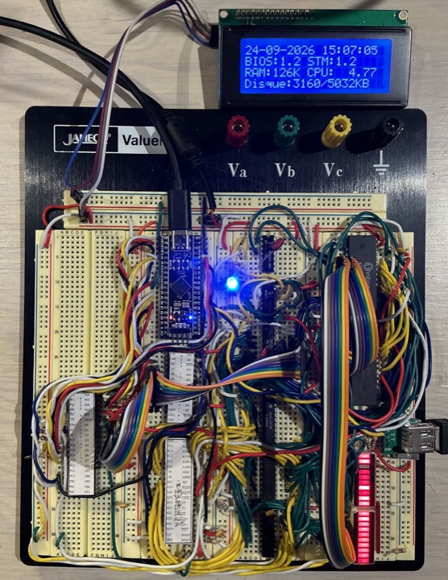
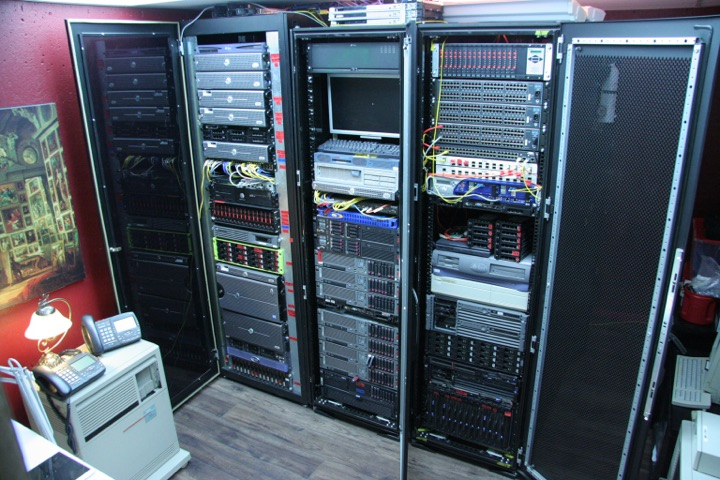

## A) Accès aux contenus de cours

 *420 · techniques de l'informatique*

-  420-1C4 · [Objets connectés](https://ve2cuy.github.io/4201c4/)
  - Arduino, Wokwi, modules Grove
-  420-1C5 · [Ordinateurs et systèmes d'exploitation](https://ve2cuy.com/index.php/420-1c5-documents/)
  - Windows, Linux, CMD et bash
-  420-3C3 · [Installation de serveurs](https://ve2cuy.github.io/4203c3/)
  - Documents de cours
-  420-4D4 · [Conteneurs et orchestration](https://ve2cuy.github.io/4204d4/)
  - Docker, Compose, Kubernetes
-  420-5D3 · [Sécurité des données](https://ve2cuy.com/index.php/420-5d3-documents/)
  - Documents de cours
-  420-21E · [Environnement de développement Web 2](https://ve2cuy.com/420-21e/)
  - Mise en production d'un site
-  + · [Stages en informatique](https://stages420.ve2cuy.com/)
  - Horaire et dates importantes

## B) Émulation d'ordinateurs « vintage »

 *Les émulateurs roulent dans un fureteur, programmés sous Rust et WebAssembly*

-  - · [TRS-80](https://ve2cuy.github.io/trs80-emu/) · micro-ordinateur · [Dépôt GitHub](https://github.com/ve2cuy/trs80-emu)
  - Model 1, 2, 3 et 4
-  - · [VAXstation 3900](https://ve2cuy.github.io/vax-emu/) · station de travail · [Dépôt GitHub](https://github.com/ve2cuy/vax-emu)
  - OpenVMS et DECwindows
-  - · [IBM System/370](https://ve2cuy.github.io/ibm-z-emu/) · ordinateur central · [Dépôt GitHub](https://github.com/ve2cuy/ibm-z-emu)
  - MVS 3.8j (TK5) et z/Architecture

## C) L'atelier

 *Projets hors des cours*

-  - · [breadboard-PC](https://github.com/ve2cuy/breadboard-PC) · github · 2026
  - Un Intel 8088 sur plaques d'essai : ROM en assembleur 8086, BASIC, PC-DOS 2.1 et MS-DOS 3.30
-  - · [My home data center](https://ve2cuy.github.io/blog/Documentation/My-home-data-center.html) · blogue
  - Les baies, les serveurs sous vCenter, le BladeCenter et la téléphonie IP de la maison
-  - · [Les projets de VE2CUY](https://ve2cuy.github.io/blog/) · blogue
  - PIC 18F, afficheurs LCD en I2C et les autres projets
-  - · [Introduction à Xcode](https://ve2cuy.com/xcode/) · xcode
  - Contenu par blocs de semaines et tâches à faire
-  - · [Liens](https://ve2cuy.com/index.php/liens/) · liens

## L'auteur

**Alain Boudreault** (VE2CUY), enseignant au département de Techniques de l'informatique, Cégep de Saint-Jérôme

- **Courriel** : [Aboudrea@cstj.qc.ca](mailto:Aboudrea@cstj.qc.ca)
- **Téléphone** : poste 6516
- **Local** : D125e
